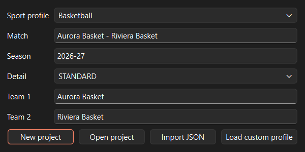
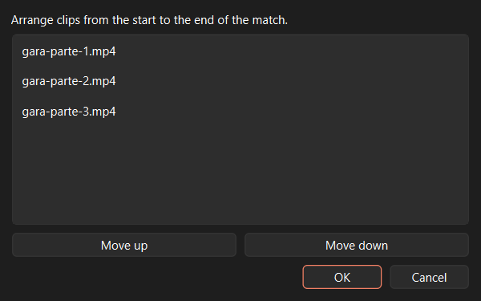
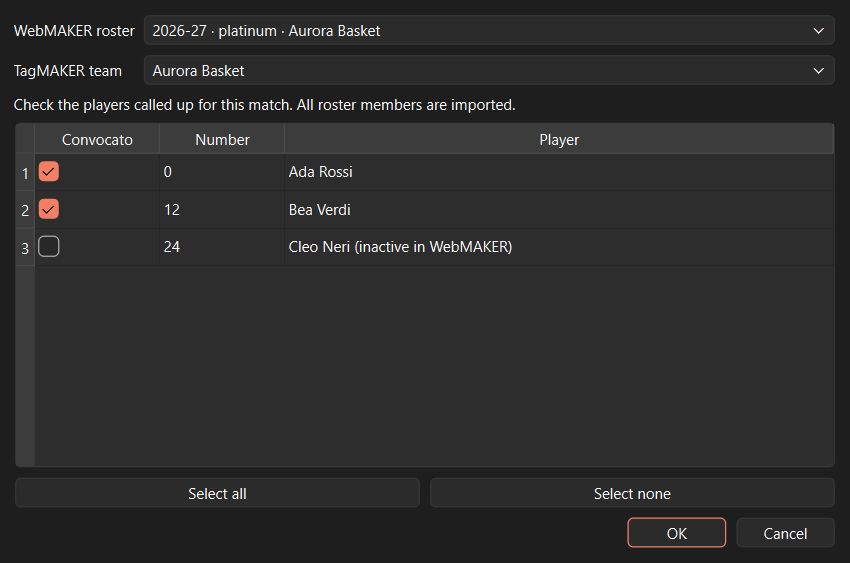
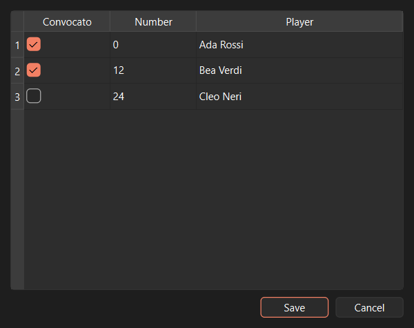
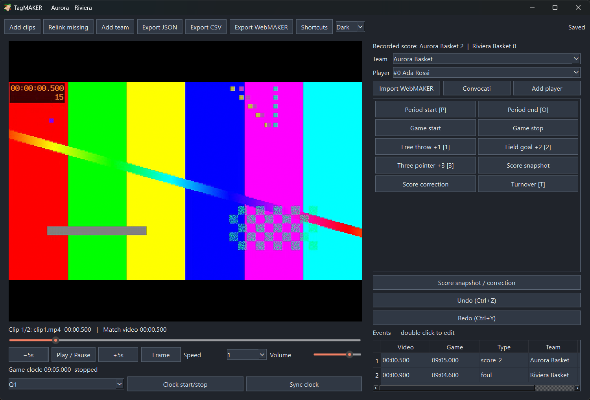
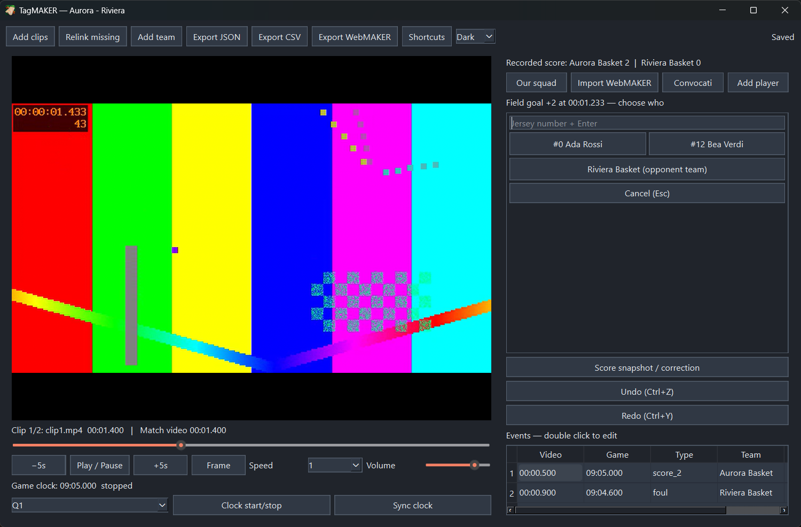

# TagMAKER 0.1 — Windows prototype guide

TagMAKER is an offline desktop application for manually annotating recorded basketball and football matches. The project is stored in SQLite; video stays in separate files. Qt provides the interface and native libmpv decodes the video. This repository is still a **source prototype**, with no published installer or release.

The screenshots below show the real application with synthetic teams, players, and footage.

## Complete tutorial

### 1. Install and start

Install Python 3.11 or newer and make a 64-bit `libmpv-2.dll` available on `PATH`. From the TagMAKER repository in **PowerShell**:

```powershell
py -3 -m venv .venv
.\.venv\Scripts\python.exe -m pip install -e ".[test]"
$env:PATH = "C:\path\to\libmpv;$env:PATH"
.\.venv\Scripts\tagmaker.exe
```

In **Command Prompt (`cmd.exe`)**, use `set` instead of PowerShell's `$env:` syntax:

```bat
set "PATH=C:\path\to\libmpv;%PATH%"
.\.venv\Scripts\tagmaker.exe
```

Set `PATH` and launch TagMAKER in the same terminal. The developer's `.venv-uv` and `.local-tools` directories are local test tools and are not distributed. The future installer must choose and audit an exact libmpv/FFmpeg build before bundling it.

### 2. Create or reopen a match

Choose a sport profile, match name, season, tagging detail level, and teams. Select **New project** and save a `.sqlite3` file. **Open project** resumes an existing database. **Import JSON** converts a TagMAKER 0.1 export into a new database. **BASIC**, **STANDARD**, and **ADVANCED** expose progressively more event types; the embedded profile also controls periods and shortcuts.



### 3. Add and order clips

Select **Add clips** and choose a recording. The picker includes `.mp4`, `.mkv`, `.mov`, `.avi`, `.webm`, `.m4v`, **`.mts`**, and **`.m2ts`**; **All files** is available for other formats libmpv may support. If the match spans several files, arrange them from beginning to end in the next dialog. TagMAKER treats them as one sequential video timeline, not as synchronized camera angles.



The source label shows the current clip time and whole-match video time. Use play/pause, five-second jumps, frame step, speed, volume, and the seek bar. Clips are read from disk as needed and are not embedded in SQLite or JSON. If a file moves, choose **Relink missing** and select the same recording; TagMAKER checks its size to protect saved timestamps.

### 4. Import a WebMAKER roster and choose the called-up players

Select **Import WebMAKER** and choose a WebMAKER project folder with `site/data/rosters.csv`, `site/data/teams.yaml`, and `site/data/players/*.yaml` or `*.yml`. TagMAKER reads these files without changing them. Choose the source season, competition, and team, then map that team to a TagMAKER team or create one.

Tick the players called up for this match. Everyone in the selected roster is imported, but only called-up players appear when you assign a tag, with **jersey number and name**. Players marked inactive in WebMAKER start unticked. **Convocati** edits this selection later. Reimporting refreshes roster information while retaining TagMAKER player IDs already used by events. **Our squad** chooses which TagMAKER team has individual players; other teams are tagged as a whole.





### 5. Tag the video

Click an event button or use its displayed shortcut. For a player or team event such as a basket, the buttons change to the called-up players in **Our squad** and a single team-level choice for each opponent. Click a player or type their jersey number and press `Enter`; click the opponent's team button to record an event without an opponent player. `Esc` or **Cancel** discards the pending tag. The video timestamp is captured when you first choose the event, even if playback continues while you select the actor. Period and game controls record immediately. The event buttons are in two columns with a 4 px row gap; a compact history is below them.





General shortcuts: `Space` toggles playback, `←` and `→` jump five seconds, `.` steps one frame, `Ctrl+Z` undoes, and `Ctrl+Y` redoes. Event shortcuts depend on the sport profile. **Shortcuts** lets you change them and detects conflicts. Double-click a history row to edit or remove an event, including its note, team, player, attributes, and event relationships.

### 6. Synchronize the match clock and score

Video time includes introductions, breaks, and stoppages. It is **independent of the official match clock**. Select a period, pause at a frame with a readable scoreboard, choose **Sync clock**, and enter the visible `MM:SS.mmm` value. At the start of a basketball quarter, for example, select `Q1`, sync the displayed starting time (such as `10:00.000`, if that is the competition's rule), then use **Clock start/stop** at the frame where the official clock begins. Use the same button when the official clock stops and resumes. The game's clock runs from *video position*, so pausing the video also freezes the displayed clock; seeking past stoppages can make it inaccurate. Sync again whenever the scoreboard shows a reliable time, especially after seeking. Without a manual sync, an event still has video time, but `game_clock_ms` is null.

At a period boundary, click **Clock start/stop** if the clock is running, then **Period end** to record a marker. Select the next period, sync its displayed starting value, record **Period start**, and click **Clock start/stop** when play begins if it is stopped. **Period start/end** and the event-grid **Game start/stop** buttons are markers; they do not change the clock's running state. Tag chronologically when possible: the project stores the current clock anchor, while each saved event keeps its captured game time.

Choose a scoring event, then assign it to one of our players or the opposing squad. The on-screen score initially sums observed scoring tags. If tagging starts in the middle of a match or events are missing, use **Score snapshot / correction** to record known team totals. A partial tag log must not be treated as a verified final result.

### 7. Save, reopen, and relocate

Changes are saved automatically to SQLite, and the status indicator shows when saving has finished. Closing waits for pending writes. Reopening restores events, clock state, roster, and media references. When moving to another computer, copy the database **and** its video files; use **Relink missing** if paths changed. **Export JSON** includes a relative media manifest where possible, never the video bytes.

### 8. Export to the PlayMAKER suite

| Flow | Available now | How to use it |
| --- | --- | --- |
| WebMAKER → TagMAKER | Roster import | Import a source project, map the team, and choose called-up players. Reimport after source roster changes. |
| TagMAKER → VideoMAKER | Versioned JSON contract; VideoMAKER importer still to be built | Use **Export JSON**. The shared [`playmaker-schema` contract](../playmaker-schema/README.md) defines IDs, ordered clips, millisecond timestamps, game clock, relations, and score corrections. VideoMAKER can develop its importer against the fixture. |
| TagMAKER → WebMAKER sites | Per-game player-stat CSV | Use **Export WebMAKER**, select the WebMAKER source project and an existing game, then save the CSV. In WebMAKER Studio, open the player statistics section, choose **Import CSV**, review the draft, and save the site data. Publishing remains a WebMAKER action. |

The WebMAKER export uses the source `game_id` and imported `webmaker_player_id`. It maps observed free throws, two- and three-point scores, fouls, offensive/defensive rebounds, assists, and turnovers to Studio's columns. **Minutes and unobserved statistics stay blank.** Generic rebounds are not silently classified as offensive or defensive; team-only events cannot be assigned to a player. The export rejects tagged players without a WebMAKER ID or with a team mismatch. Studio adds **new** `(game_id, player_id)` records and skips existing ones, so review or edit an existing row directly in Studio when replacing statistics. The older **Export CSV** remains a TagMAKER aggregate reference, not a WebMAKER import file.

JSON details are in [format 0.1](docs/format-0.1.md). The shared schema, validator, and fixtures live in the sibling [`playmaker-schema` folder](../playmaker-schema/README.md), connected to the [PlayMAKER-apps/playmaker-schema repository](https://github.com/PlayMAKER-apps/playmaker-schema).

### 9. Troubleshooting

- **`.MTS` is not shown:** update to this revision; the file picker now lists `.mts` and `.m2ts` in either case. **All files** also opens a file when libmpv recognizes its contents. A local 1080p `.MTS` was opened, sought, and played in the native backend.
- **libmpv is not found:** check that Python and the DLL are both 64-bit and that the DLL directory is in the launching terminal's `PATH`.
- **`$env:PATH` gives a syntax error:** the terminal is `cmd.exe`; use the `set "PATH=...;%PATH%"` form above.
- **A player is missing:** check **Our squad** and **Convocati**; only called-up players of our squad appear in the actor buttons.
- **Match clock is blank:** synchronize it; video time alone cannot establish official match time.
- **A clip is missing:** use **Relink missing** with the original recording.

## Testing and release readiness

The [verification record](docs/testing.md) covers automated tests, native playback smoke tests, and a sampled benchmark on a **71 min 43 s, 1920×1080, 21.05 GB MP4** plus a **17 min 21 s, 1920×1080 `.MTS`** from the same local recording set. The real-file check sampled startup, seeks, eight seconds of playback, and process RAM. It is not a sustained 90-minute run or a decoded-frame latency guarantee.

Before the first public release, the remaining gates are a sustained full-match playback and recovery test on a modest PC; hands-on annotation with real users; a versioned VideoMAKER importer with round-trip tests; and a redistribution audit of the exact libmpv/FFmpeg build followed by a clean-machine GUI installer test. A **private, ignored installer candidate** has been compiled, installed, started, and uninstalled locally; see [packaging](packaging/README.md). The [license review](docs/licenses.md) records what must be verified. No installer or portable package is published yet.

A Rust rewrite is not planned for this MVP. Video decoding already runs in native libmpv and SQLite writes outside the UI thread. A port would need measured Python/Qt bottlenecks on representative matches to justify its cost.

## Development

```powershell
.\.venv\Scripts\python.exe -m pytest -q
.\.venv\Scripts\python.exe -m compileall -q app playback tagging storage
```

`app/` contains the Qt UI, `playback/` wraps libmpv and sequential clip timing, `tagging/` contains the model, sport profiles, and clock, and `storage/` owns SQLite, WebMAKER integration, and exports. Sport profiles are JSON-compatible YAML 1.2 files. Copy a file in `profiles/` to define a custom sport, periods, levels, event types, default points, and shortcuts. The selected profile is embedded in new projects so they can reopen elsewhere.
